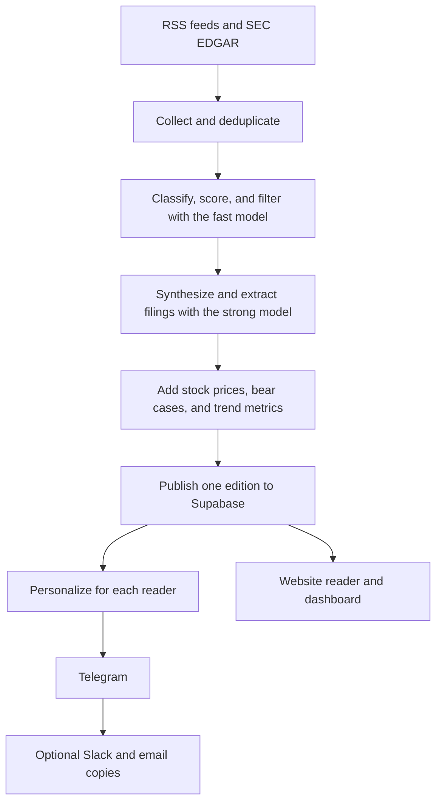

# Goldirham Stack

A daily briefing on AI infrastructure, delivered through Telegram at each reader's chosen time. The pipeline reads 68 RSS feeds, watches SEC filings from 35 companies, analyzes the results with AI, and publishes one edition per day. It covers power generation, cooling, networking, chips, and AI models.

- **Website:** [goldirham-stack.vercel.app](https://goldirham-stack.vercel.app)
- **Reader:** [/briefing/](https://goldirham-stack.vercel.app/briefing/)
- **Dashboard:** [/dashboard/](https://goldirham-stack.vercel.app/dashboard/)

Goldirham Stack is an informational tool, not financial advice. Do your own research before you make an investment decision.

## Current status

Last reviewed on 2026-11-02. The package version is `1.1.0`.

| Area | Status |
|---|---|
| Daily publishing | Running. 64 editions published. |
| Telegram bot | Deployed as a webhook service on Render. |
| Website | Deployed on Vercel. |
| Workflow timing | GitHub started the digest cron 1.8 to 3.7 hours late, and ran the 10-minute delivery cron about every 4.4 hours (median gap, 2026-10-18 to 2026-11-02). pg_cron now dispatches both workflows on schedule, and GitHub's own crons stay as a backstop. Delivery dispatch started working on 2026-11-02 at 14:50 UTC. The first digest dispatch is due at 22:17 UTC. |
| Stock quotes | Fix merged on 2026-11-02, not yet seen in a production run. The 1,307 rows stored before the fix all show 0% change. |
| SEC extracts | Fix merged on 2026-11-02, not yet seen in a production run. None of the 64 published editions contains an extract. |
| Email copies | Health unverified. A past run failed Gmail authentication with `535-5.7.8`. Email and Slack failures do not stop delivery. |
| RSS | 65 of 68 feeds succeeded in the latest recorded check. AI News, VentureBeat AI, and Yahoo Finance failed. |
| SEC coverage | 35 companies are tracked. ANSS no longer appears in EDGAR's ticker list. |

These optional stages are off in production because their keys are not configured. A missing key affects only its own stage.

| Stage | Enable with | Behavior without a working key |
|---|---|---|
| Embeddings | `OPENAI_EMBEDDING_API_KEY`, or `OPENAI_API_KEY` locally | Deduplication uses URL and Jaccard matching. The semantic relevance gate is skipped. |
| Earnings transcripts | `ROIC_AI_API_KEY` | Earnings collection and analysis are skipped. |
| AI provider fallback | `AI_FALLBACK_API_KEY`, plus optional `AI_FALLBACK_*` settings | The primary provider runs alone. |

## How it works

The pipeline generates one immutable edition per day, then personalizes that edition for each reader. Delivery never calls an AI model and receives no AI credentials.



`daily-digest.yml` runs the generation stage at 06:17 MYT (22:17 UTC). `scheduled-delivery.yml` checks every 10 minutes for readers whose preferred time has passed and who have no successful delivery for their local date. A late run still delivers, because the check uses the date and not a narrow time window.

## Features

### News pipeline

- Reads 68 RSS feeds in 2 tiers: 50 company and financial feeds, and 18 industry feeds.
- Uses conditional GET with ETag and Last-Modified headers, so unchanged feeds return 304.
- Retries failed feeds up to 2 times with full-jitter backoff. It skips a feed after 2 or more consecutive failed runs, and flags a feed as likely dead after 3.
- Matches ticker keywords as case-sensitive whole words, and accepts only http and https links.
- Deduplicates by URL and Jaccard title similarity. With embeddings enabled, it also uses cosine similarity at a 0.85 threshold.
- Sorts articles into 10 sectors: Chips & GPUs, Cloud & Hyperscalers, Datacenters, Networking, Semiconductor Manufacturing, Power & Utilities, Cooling Infrastructure, AI Models & Labs, M&A, and Earnings.
- Drops articles with an AI relevance score below 4 out of 10. With embeddings enabled, it also compares each article with 20 AI infrastructure seed sentences at a 0.55 threshold.
- Marks SEC-related articles with a badge in the digest and `is_sec_filing` in Supabase.

### AI processing

- Works with Groq (the default), OpenAI, OpenRouter, or a custom endpoint.
- Routes classification to a fast model (`openai/gpt-oss-20b`) and synthesis to a strong model (`openai/gpt-oss-120b`).
- Sizes batches at 5 to 15 articles, aiming for about 4 batches, and retries up to 3 times with full-jitter backoff.
- Scores impact from 1 to 10: 1 to 3 is routine, 4 to 6 is notable, 7 to 8 is a significant surprise, and 9 to 10 is market-moving. A score of 8 or more requires a written justification.
- Writes a skeptical bear case for high-impact articles, and a bull, bear, and context deep-dive for the highest-scoring article.
- Links articles to same-run SEC filings, earnings guidance, and stock moves for matching tickers.
- Caches AI responses for 23 hours, keyed on a SHA-256 hash of the source content and the prompt, schema, provider, and model.
- Parses every AI JSON response through a zod schema, which coerces type-confused fields such as a number returned as a string.
- Records prompt, completion, and total tokens per run, along with both model names.

RSS content reaches the model as fenced, escaped JSON, with a system instruction to treat article fields as data. This reduces prompt-injection exposure but does not guarantee immunity.

### Ranking

Each article's effective score combines its impact and relevance with source credibility, reader votes, sector trust, corroboration from other sources, and penalties for repeats and press-wire copy. Press-wire articles are capped at 6. Articles that repeat coverage from the past 48 hours get a 0.6 multiplier. Each article stores a versioned explanation of its score, and detailed digests show the useful reasons.

### SEC filings

The EDGAR watcher tracks 8-K, 6-K, 10-K, 10-Q, and their amendments for 35 companies. Foreign filers such as TSM, ASML, and ARM report on Form 6-K. Extraction has three passes:

1. A free keyword filter looks for capex, AI revenue, margin, and guidance terms.
2. The fast model flags relevant filings, at about $0.0005 per filing. Earnings releases with enough dollar figures skip this pass.
3. The strong model extracts numbers from flagged filings, at about $0.01 per filing.

Extracts cover capex, capex guidance, AI and data center revenue, gross and operating margins, inventory, and revenue and EPS guidance. Each gets a 1 to 10 impact score with a rationale. Filings the flagging pass rejects are recorded in `sec_filing_reviews`, so they are not analyzed again on every run.

### Earnings transcripts

This optional stage reads transcripts for 15 companies from Roic.ai. The fast model segments each call by topic, and the strong model extracts guidance, AI revenue, and management tone. The digest shows quarter-over-quarter guidance changes from data stored in Supabase.

### Delivery

Telegram is the primary channel. Optional Slack and verified email copies send only after Telegram succeeds. A failed copy is non-fatal and cannot cause a duplicate Telegram retry.

Each reader's copy is filtered by stored preferences:

- `min_impact_score` drops articles below the reader's threshold.
- `categories_enabled` keeps only the selected sectors.
- `watchlist` and `watchlist_mode` rank watched tickers first, or show only those tickers.
- `digest_length` is `brief`, `standard` (the default), or `detailed`.

The `claim_user_delivery` RPC claims each delivery atomically before sending. Confirmed failures can retry. Pending and ambiguous sends are never replayed automatically and require manual reconciliation with evidence, because replaying one could send a duplicate.

After delivery, a follow-up message offers thumbs-up and thumbs-down buttons on the top 3 articles. Votes feed the trust multipliers used in ranking.

### Website

The landing page, reader, and dashboard are static HTML and vanilla JavaScript with no build framework. The dashboard reads Supabase with the public anon key under row-level security. It has 8 Chart.js charts, a stock ticker strip, sector and impact filters, indexed full-text search, expandable article rows with ranking reasons, a filings table, and thesis snapshots. It refreshes every 5 minutes while the page is visible.

### Quality alerts

`src/pipeline/quality.ts` checks each edition against a table of rules. Issues go to Slack and `digest_runs.degraded_stages`, and they never block publication.

| Rule | Fires when |
|---|---|
| `prices_flat` | Every stock quote shows 0% change. |
| `thin_edition` | An edition has fewer than 10 articles. |
| `sec_no_extracts` | The last 14 editions contain no SEC extract. |
| `deliveries_held` | Delivery slots stay held past a 30-minute grace period. |
| `delivery_late` | The latest delivery was more than 30 minutes late. |

The pipeline also alerts when more than 20% of feeds fail, and it runs optional stages through `tryStage`, so one failing stage does not stop the run. High-impact alerts for scores of 8 or more go to readers who opt in, and a claim prevents repeats across reruns. AI budgets are advisory by default and use provider-reported costs. Unknown prices produce a warning, not a zero-dollar estimate.

## Bot commands

`npm run dev` runs a short-lived polling listener. For commands to work around the clock, deploy `src/webhook.ts`. Personal commands work only in private chats.

| Command | Description |
|---|---|
| `/start` | Run onboarding: delivery time, watchlist, impact filter, and digest length. |
| `/help` | List the commands. |
| `/digest`, `/last` | Read the latest published edition. These commands spend nothing on AI. |
| `/digest watchlist` | Read the latest edition filtered to your watchlist. |
| `/digest sector=Chips_&_GPUs` | Read the latest edition filtered to one sector. |
| `/sources` | Show feed health. |
| `/sources quality` | Rank sources by vote-learned trust. |
| `/trending` | Show what is trending over the last 7 days. |
| `/trends NVDA 30d` | Show a sparkline and week-over-week change for a ticker. Defaults to NVDA and 30 days. |
| `/trends sector Datacenters 30d` | Show the same for a sector. |
| `/sec NVDA` | Show the latest filing highlights for a ticker. |
| `/coverage NVDA 14` | Show recent article coverage for a ticker. Defaults to 14 days. |
| `/thesis NVDA` | Show the last 6 weekly bull and bear snapshots. With no ticker, shows the top 5 by confidence. |
| `/feedback 5` | Rate today's digest from 1 to 5, with an optional comment. |
| `/watchlist NVDA,AMD,AVGO` | Set your watchlist. |
| `/personalization prioritize` | Rank watched tickers first. Use `only` to show nothing else. |
| `/settings` | View your preferences. |
| `/settings time 08:00` | Set your delivery time. Also accepts `timezone`, `min_score`, `length`, and `categories`. |
| `/delivery` | Configure email or Slack copies. |
| `/delivery email you@example.com` | Send a 6-digit code to verify ownership of an address. |
| `/delivery email verify 123456` | Verify the address and enable email copies. |
| `/delivery slack WEBHOOK_URL` | Send copies to a private Slack Incoming Webhook. |
| `/alert on`, `/alert off` | Turn high-impact alerts on or off. |
| `/alert threshold 9` | Set the minimum score for alerts. |
| `/watch NVDA 130` | Get one notification when NVDA crosses $130. Fresh quotes are checked at daily delivery, so this is not a real-time monitor. |
| `/watch NVDA off`, `/watch list` | Clear a watch, or list your watches. |
| `/stop`, `/unsubscribe` | Stop scheduled delivery. |
| `/resume` | Resume delivery after completed onboarding. |
| `/delete_my_data`, `/delete` | Delete your private data and disable delivery. |

## Quick start

You need Node.js 22 (see `.nvmrc`), a Telegram bot token from [@BotFather](https://t.me/BotFather), an AI key from [Groq](https://console.groq.com), [OpenAI](https://platform.openai.com), or [OpenRouter](https://openrouter.ai), and a [Supabase](https://supabase.com) project.

```bash
npm install
cp .env.example .env
```

Fill in `.env`. Keep real values out of `.env.example`, because git tracks it and the repository is public.

To find your Telegram chat ID, message your bot, run this command, and copy `chat.id` into `.env`:

```bash
curl https://api.telegram.org/bot<TOKEN>/getUpdates
```

These commands run the project locally. `npm run dev` has real side effects: it sends a Telegram message, spends AI credits, and writes to Supabase.

```bash
npm run dev                 # Run the pipeline once
npm run scheduler           # Run one delivery check
npm run webhook             # Start the webhook server
npm run preflight           # Validate configuration without network calls
npm run preflight:network   # Run read-only authentication checks; sends nothing
```

## Configuration

`TELEGRAM_BOT_TOKEN`, `TELEGRAM_CHAT_ID`, and `AI_API_KEY` are required. Everything else is optional, and `.env.example` shows the format.

| Variable | Default | Description |
|---|---|---|
| `TELEGRAM_BOT_TOKEN` | | Bot token from @BotFather. |
| `TELEGRAM_CHAT_ID` | | Default chat or user ID. |
| `AI_API_KEY` | | Key for the AI provider. |
| `AI_PROVIDER` | `groq` | `groq`, `openai`, `openrouter`, or `custom`. |
| `AI_BASE_URL` | | Endpoint for the `custom` provider. |
| `AI_MODEL` | `openai/gpt-oss-120b` | Strong model for synthesis and SEC extraction. |
| `AI_FAST_MODEL` | `openai/gpt-oss-20b` | Fast model for classification and SEC flagging. |
| `AI_FALLBACK_PROVIDER` | | Provider tried once if the primary fails after all retries. |
| `AI_FALLBACK_API_KEY` | | Enables failover. |
| `AI_FALLBACK_BASE_URL` | | Endpoint for a custom fallback provider. |
| `AI_FALLBACK_MODEL` | `gpt-4o-mini` | Strong model on the fallback provider. |
| `AI_FALLBACK_FAST_MODEL` | `gpt-4o-mini` | Fast model on the fallback provider. |
| `MAX_ARTICLES_FOR_AI` | `35` | Maximum deduplicated articles per run, clamped to 1 to 100. |
| `AI_BUDGET_DAILY_USD` | `0.50` | Daily threshold for known AI spend. |
| `AI_BUDGET_MONTHLY_USD` | `5.00` | 30-day threshold for known AI spend. |
| `AI_BUDGET_MODE` | `advisory` | `advisory` or `enforced`. `enforced` requires reviewed `ai_model_prices` rows. |
| `SUPABASE_URL` | | Supabase project URL. |
| `SUPABASE_SERVICE_KEY` | | Service role key. Never ship it to a browser. |
| `OPENAI_EMBEDDING_API_KEY` | | Key for `text-embedding-3-small`. Persistent HTTP 429 responses fall back to URL and Jaccard matching for that run. |
| `ROIC_AI_API_KEY` | | Key for earnings transcripts. |
| `WEBHOOK_URL` | | Public URL. The server registers it with Telegram on startup. |
| `WEBHOOK_SECRET` | | Required to start `src/webhook.ts` at all. Not needed for `npm run dev` or `npm run scheduler`. |
| `WEBHOOK_PATH` | `/telegram/webhook` | Path that receives updates. |
| `PORT` | `3000` | Webhook server port. |
| `TELEGRAM_MODE` | | `send-only`, `polling`, or `webhook`. |
| `TZ` | `Asia/Kuala_Lumpur` | Timezone used for run dates. |
| `SLACK_WEBHOOK_URL` | | Slack Incoming Webhook for the default copy. |
| `SMTP_USER` | | Gmail address that owns the App Password. |
| `SMTP_PASS` | | 16-character Gmail App Password with no spaces. |
| `DIGEST_EMAIL_TO` | | Recipient for the default email copy. |

`SMTP_PASS` must be a [Google App Password](https://myaccount.google.com/apppasswords), not your account password. Gmail rejects an account password with `535-5.7.8 Username and Password not accepted`. App Passwords require 2-Step Verification. To test the credentials without a full pipeline run, use this command:

```bash
npx tsx scripts/test-email.ts
```

## Production

| Component | Where it runs |
|---|---|
| Editorial pipeline and delivery | GitHub Actions |
| Workflow timing | pg_cron and pg_net in Supabase |
| Bot commands | Webhook server on Render, built from the `Dockerfile` |
| Database | Supabase (Postgres and pgvector) |
| Website | Vercel, project `goldirham-stack` |

Merging to `main` applies migrations through Supabase's GitHub integration and deploys Render. Stop the affected workers before you merge a release that includes a migration.

### Scheduled workflows

| Workflow | Schedule (UTC) | Purpose |
|---|---|---|
| `daily-digest.yml` | Daily at 22:17 | Generate and publish the edition. |
| `scheduled-delivery.yml` | Every 10 minutes | Personalize and deliver the current edition. It reads publications and delivery state only. |
| `weekly-thesis.yml` | Sunday at 04:00 | Generate bull and bear snapshots for the top 10 tickers, at about $0.01 per week. |
| `data-retention.yml` | Sunday at 03:00 | Call `cleanup_old_data()`. |
| `api-contracts.yml` | Monday at 03:41 | Check live Yahoo and EDGAR responses. |
| `ci.yml` | Push and PR to `main`, Monday at 04:19 | Run the checks listed under [Testing](#testing). |
| `codeql.yml` | Push and PR to `main`, Monday at 05:00 | Run CodeQL with the `security-extended` pack. |

Migration `20261102140000` adds pg_cron jobs that dispatch the digest and delivery workflows on time. The jobs do nothing until the Vault secret `github_actions_dispatch_token` holds a fine-grained token with Actions read and write access to this repository. GitHub's own schedules stay in place as a backstop. Never put the token in a migration.

To store or replace the token, run one of these statements in the Supabase SQL editor. Use `create_secret` the first time and `update_secret` after that.

```sql
select vault.create_secret('YOUR_TOKEN', 'github_actions_dispatch_token');
select vault.update_secret((select id from vault.secrets where name = 'github_actions_dispatch_token'), 'YOUR_TOKEN');
```

To check the result of recent dispatches, read `net._http_response`. A working dispatch returns 204.

### GitHub Actions secrets

| Secret | Purpose |
|---|---|
| `TELEGRAM_BOT_TOKEN`, `TELEGRAM_CHAT_ID` | Telegram delivery. |
| `AI_API_KEY` | AI provider. |
| `SUPABASE_URL`, `SUPABASE_SERVICE_KEY` | Database access. |
| `SLACK_WEBHOOK_URL` | Optional Slack copy and failure alerts. |
| `SMTP_USER`, `SMTP_PASS`, `DIGEST_EMAIL_TO` | Optional email copy. |
| `WEBHOOK_SECRET`, `WEBHOOK_URL` | Webhook server. |
| `OPENAI_EMBEDDING_API_KEY`, `ROIC_AI_API_KEY`, `AI_FALLBACK_API_KEY` | Optional stages, not configured in production. |

Repository variables can set optional model names, custom base URLs, the fallback provider, and budgets. Unset variables use the workflow defaults.

### Webhook server

```bash
npm run build && npm run start:webhook
```

The `Dockerfile` is a Node 22 build that runs `dist/webhook.js` as the unprivileged `node` user on port 3000. The server rejects requests without a matching `X-Telegram-Bot-Api-Secret-Token` header. See [WEBHOOK_SETUP.md](WEBHOOK_SETUP.md) for deployment steps on Render, Railway, or Fly.io.

### Operations

`scripts/operations.ts` handles the cases automation deliberately leaves to a person.

```bash
npm run operations -- status
npm run operations -- activation
npm run operations -- resolve digest ID success "evidence and reason"
npm run operations -- release-editorial YYYY-MM-DD "evidence and reason"
```

Reasons must be at least 20 characters and are kept in an audit table. Before you release a stuck editorial claim, inspect the publication and the AI ledger, because a retry can repeat paid work. The database refuses to release a claim under an hour old.

## Database

Supabase holds 35 public tables, managed by 40 migrations in `supabase/migrations/`. `supabase-schema.sql` is a historical snapshot. The migrations are canonical.

```bash
npx supabase login
npx supabase link --project-ref <your-ref>
npm run db:status    # List migration history
npm run db:diff      # Generate a migration from schema changes
npm run db:pull      # Sync the remote schema to local
npm run db:reset     # Reset the local database; requires Docker, not a login
```

Row-level security is on for all tables, and writes are limited to `service_role`. The dashboard can read public analytics tables only. Personal data such as `user_preferences` and `price_watches` is service-role only.

`cleanup_old_data()` applies these retention periods:

| Data | Kept for |
|---|---|
| Pipeline health | 30 days |
| Articles, AI usage, delivery logs, and alert logs | 90 days |
| Private product events and digest feedback | 180 days |
| Capex tracking | 365 days |

## Testing

```bash
npm run lint                  # tsc for the app and scripts
npm run test:unit             # Offline unit tests; no credentials
npm test                      # Adds mocked integration suites; no credentials
npm run verify:website        # Checks the site at 320, 768, 1024, and 1440px
npm run verify:live-contracts # Reads live Yahoo and EDGAR responses
```

`npm test` reported 616 passing tests across 69 files on 2026-11-02. `verify:website` needs a local server, and `.claude/launch.json` has a `website` configuration for port 4321.

CI runs lint, both test suites, website verification, `npm audit`, blocking Semgrep, a container check, and local Supabase migration validation. All actions are pinned to commit SHAs, and Dependabot proposes updates.

## Project layout

```
.github/workflows/    Scheduled jobs and CI
docs/                 Release notes, rollout records, and design documents
scripts/              Operations, preflight checks, backfills, and verifiers
src/
  collector/          RSS, SEC EDGAR, and earnings transcripts
  commands/           Telegram command handlers
  delivery/           Fan-out, personalization, watches, and the webhook inbox
  evaluation/         Editorial benchmark and signal-quality tools
  formatter/          Telegram HTML formatting
  pipeline/           Generation, persistence, publication, and quality alerts
  processor/          AI classification, SEC extraction, bear cases, and theses
  sender/             Telegram, Slack, and email
  utils/              Supabase access, dedup, ranking, retries, and caching
  scheduler.ts        Per-user delivery run
  webhook.ts          Webhook HTTP server
supabase/migrations/  Canonical database schema
website/              Landing page, reader, and dashboard
```

## News sources

**Tier 1, company and financial (50 feeds).** NVIDIA, Microsoft, AMD, Broadcom, Amazon, Google, Meta, TSMC, Intel, Qualcomm, Oracle, IBM, Micron, ASML, Super Micro, Dell, ARM, Arista, Cisco, Marvell, Applied Materials, Lam Research, KLA, Tokyo Electron, Digital Realty, Equinix, Constellation Energy, Vistra, GE Vernova, Siemens Energy, Vertiv, Schneider Electric, Eaton, Anthropic, xAI, Mistral AI, Cohere, SK hynix, Samsung, GlobalFoundries, MarketWatch, Yahoo Finance, CNBC, Reuters Tech, Bloomberg Tech, FT Tech, Barron's, WSJ Markets, Investor's Business Daily, and the SEC EDGAR current filings feed.

**Tier 2, industry (18 feeds).** Tom's Hardware, ServeTheHome, Ars Technica, TechCrunch, The Verge, Seeking Alpha, SemiAnalysis, The Register, Datacenter Dynamics, Semiconductor Engineering, Google AI Blog, OpenAI, AWS AI, VentureBeat AI, AI News, Medium AI, AI Business, and ZDNet AI.

## Estimated cost

These are planning estimates and have not been measured recently.

| Service | Estimated cost |
|---|---|
| GitHub Actions | Free on a public repository |
| Groq fast model, about 80% of tokens | About $0.004 per day |
| Groq strong model, about 20% of tokens | About $0.003 per day |
| SEC extraction, about 5 filings per day | About $0.02 per day |
| Supabase | Free tier (500 MB, 50k rows) |
| Telegram Bot API and Yahoo Finance | Free |
| **Total** | **Under $1 per month** |

## Further reading

- [Release notes for v1.1.0](docs/releases/v1.1.0.md)
- [Roadmap implementation and rollout record](docs/roadmap-implementation.md)
- [Stabilization record](docs/stabilization.md)
- [Implementation history](docs/implementation-history.md), including the older migration table
- [Codebase audit](AUDIT.md)
- [Open and rejected work](TODOS.md)

## License

MIT, as declared in `package.json`.
